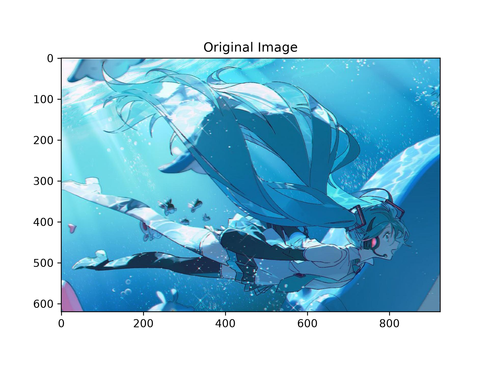
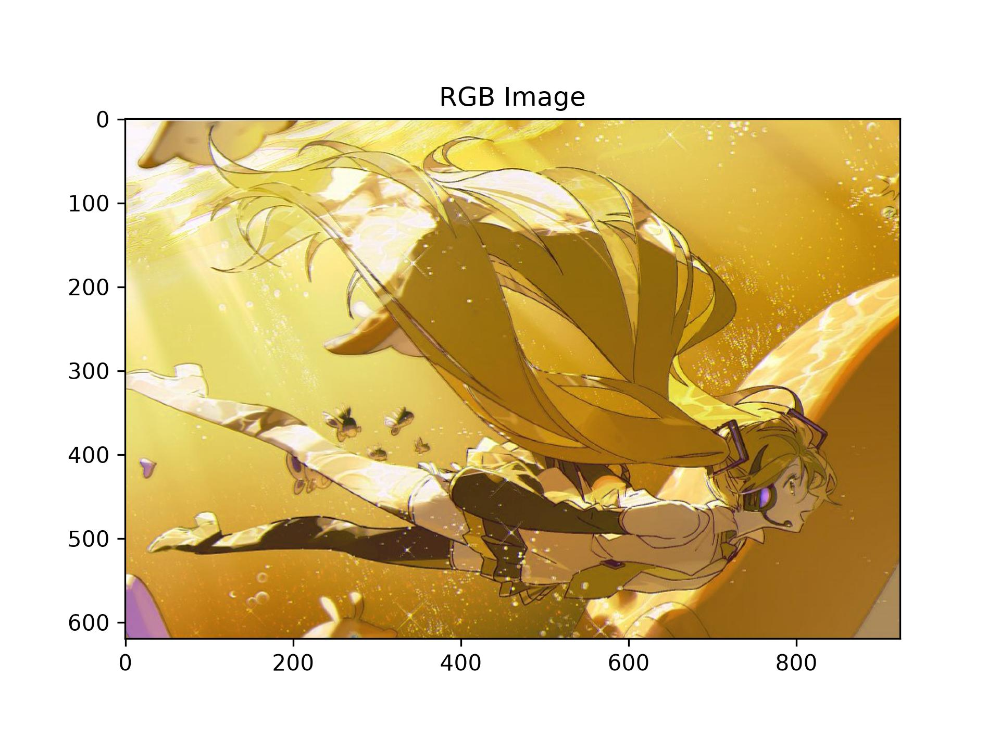
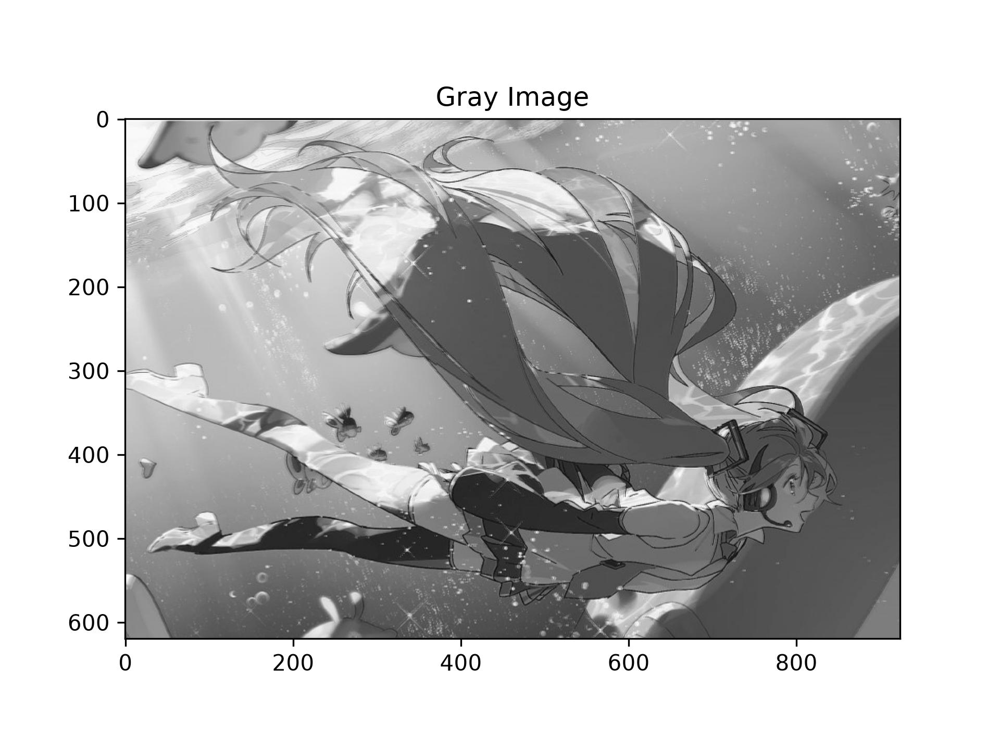
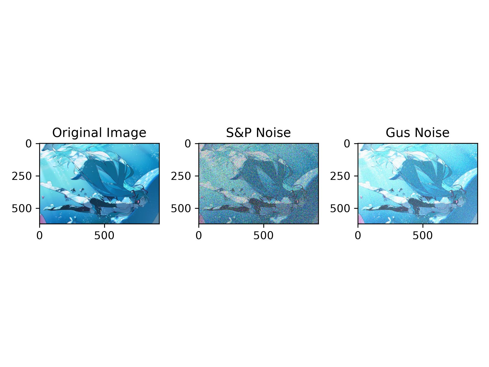
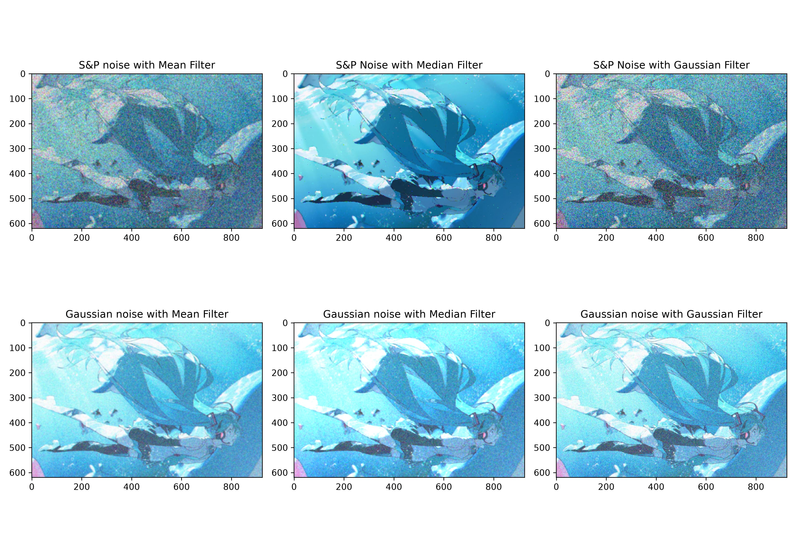
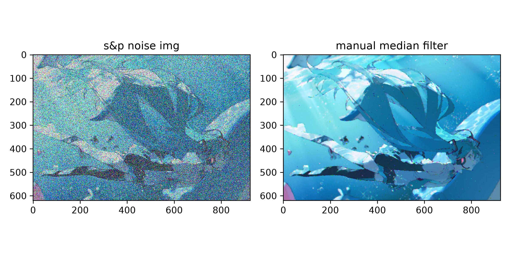

# 实验⼆：图像增强

## ⼀、实验目的

### 学会OpenCV的基本使用方法，利用OpenCV等计算机库对图像进行平滑、滤波等操作，实现图像增强。

## ⼆、实验内容

### 2.1 导入图像滤波相关的依赖包

1. OpenCV库：计算机视觉与图像处理  
2. scikit-image库：图像增强与分析，random_noise 用于给图像添加噪声  
3. NumPy库：科学计算的基础库  
4. Matplotlib库：绘图与数据可视化  


```python
import cv2
from skimage.util import random_noise
import numpy as np
from matplotlib import pyplot as plt
```

## 2.2 读取原始图像并进行色彩空间转换

下图为原计算机图像文件：  


这里获取并输⼊[100，100]处像素点的RBG参数并输出。


```python
img = cv2.imread('image.png')
rgb_img = cv2.cvtColor(img, cv2.COLOR_BGR2RGB)
(b, g, r) = img[100, 100]
print(b, g, r)
plt.imshow(rgb_img)
plt.title('Original Image')
plt.show()
```

    211 180 105
    


    

    


这里输出结果为211，180，105,对应左上角的海水背景区域，偏蓝灰色，与原图相符。  
需要注意的是plt.imshow的期望输入是RGB的顺序，而这里cv2.imread的读取顺序是BGR,所以要使用cvtcolor进行转换，否则就会红蓝通道反转。    
用以下代码显示红蓝通道反转后的结果如下:


```python
plt.imshow(img)
plt.title('RGB Image')
plt.show()
```


    

    


由于绿色的通道值不变，所以由原来的冷色调转变为了暖色调

cv2.COLOR_BGR2GRAY作用是将原始图像的RBG格式转换为灰度图，将三维的RGB通道映射为⼀维的灰度通道，效果如下所示


```python
gray_img = cv2.cvtColor(img, cv2.COLOR_BGR2GRAY)
plt.imshow(gray_img, cmap='gray')
plt.title('Gray Image')
plt.show()
```


    

    


### 2.3 添加噪声

这里在原始图像的基础上添加噪声，引入了两个API方法，椒盐噪声和⾼斯噪声。  通过对比可以发现，椒盐噪声和⾼斯噪声的本质不同，椒盐噪声表现为像素会随机替换为白色或者黑色像素（灰度通道），在RGB通道表现为像素变成随机彩色点，而高斯噪声会在每个像素上添加随机偏差，服从⾼斯分布，效果如下所示。


```python
#椒盐噪声
sp_noise_img = random_noise(rgb_img, mode='s&p', amount=0.4)
plt.subplot(1, 3, 1)
plt.imshow(rgb_img, cmap='gray')
plt.title('Original Image')
#高斯噪声
gus_noise_img = random_noise(rgb_img, mode='gaussian', mean=0.2, var=0.03)
plt.subplot(1, 3, 2)
plt.imshow(sp_noise_img, cmap='gray')
plt.title('S&P Noise')

plt.subplot(1, 3, 3)
plt.imshow(gus_noise_img, cmap='gray')
plt.title('Gus Noise')
plt.tight_layout()
plt.show()
```


    

    


### 2.4 图像滤波

将图像产生噪声后，用OpenCV的三个API滤波方式进行对比，分别对椒盐滤波和⾼斯滤波使用[均值滤波]，[中值滤波]，[⾼斯滤波]，对比每个最适合的滤波方式，结果如下所示


```python
#均值滤波
mean_sp = cv2.blur(sp_noise_img, (5, 5))
mean_gus = cv2.blur(gus_noise_img, (5, 5))
#中值滤波
mid_sp = cv2.medianBlur((sp_noise_img*255).astype(np.uint8), 5)
mid_gus = cv2.medianBlur((gus_noise_img*255).astype(np.uint8), 5)
#高斯滤波
gauss_sp = cv2.GaussianBlur((sp_noise_img*255).astype(np.uint8), (5, 5), 0)
gauss_gus = cv2.GaussianBlur((gus_noise_img*255).astype(np.uint8), (5, 5), 0)

plt.figure(figsize=(13, 9))
#第一行为椒盐噪声
plt.subplot(2, 3, 1)
plt.imshow(mean_sp)
plt.title("S&P noise with Mean Filter")
plt.subplot(2, 3, 2)
plt.imshow(mid_sp)
plt.title("S&P Noise with Median Filter")
plt.subplot(2, 3, 3)
plt.imshow(gauss_sp)
plt.title("S&P Noise with Gaussian Filter")
#第二行为高斯噪声
plt.subplot(2, 3, 4)
plt.imshow(mean_gus)
plt.title("Gaussian noise with Mean Filter")
plt.subplot(2, 3, 5)
plt.imshow(mid_gus)
plt.title("Gaussian noise with Median Filter")
plt.subplot(2, 3, 6)
plt.imshow(gauss_gus)
plt.title("Gaussian noise with Gaussian Filter")
plt.tight_layout()
plt.show()
```

    Clipping input data to the valid range for imshow with RGB data ([0..1] for floats or [0..255] for integers). Got range [0.12931827701413187..1.0000000000000024].
    


    

    


### 2.5 手动实现⼀个滤波方式（中值滤波）

以下为实现中值滤波的代码及其结果：


```python
def manual_median_filter_color(image, kernel_size=5):
    pad = kernel_size // 2
    filtered_img = np.zeros_like(image)
    for c in range(3): 
        channel = image[:, :, c]
        padded_channel = np.pad(channel, pad_width=pad, mode='edge')
        for i in range(channel.shape[0]):
            for j in range(channel.shape[1]):
                region = padded_channel[i:i + kernel_size, j:j + kernel_size]
                filtered_img[i, j, c] = np.median(region)
    return filtered_img
#对之前进行过椒盐噪声的图进行手动中值滤波   
manual_mid = manual_median_filter_color((sp_noise_img * 255).astype(np.uint8))
#对比
plt.figure(figsize=(8, 4))
plt.subplot(1, 2, 1)
plt.imshow(sp_noise_img, cmap='gray')
plt.title("s&p noise img")
plt.subplot(1, 2, 2)
plt.imshow(manual_mid, cmap='gray')
plt.title("manual median filter")
plt.tight_layout()
plt.show()
```


    

    


## 三、实验结果与分析

### 1.原始图像与颜色空间转换

知道plt.imshow的期望输入是RGB的顺序，而cv2.imread的读取顺序是BGR，会通过转换显示正确的原始图片  
会使用灰度图显⽰则突出图像的亮度信息，有助于后续图像处理分析。

### 2.噪声添加效果

椒盐噪声为在图上按一定概率随机选取像素点，将其替换为纯白点或纯黑点。  
高斯噪声为对图上所有像素点都叠加一个服从高斯分布的随机扰动值。  
对比试验显示，椒盐噪声的图会呈现离散坏点，而高斯噪声会表现为蒙了一层雪花

### 3.滤波去噪效果

均值滤波：
对⾼斯噪声的去除效果较好，能够平滑整幅图像，但对椒盐噪声中的尖锐⿊⽩点去除不彻底，且容易造成边缘模糊。  
中值滤波：
对椒盐噪声的去除效果显著，能有效保留图像边缘和细节；对
⾼斯噪声也有⼀定的抑制作⽤，但整体去噪效果略逊于均值滤波。  
⾼斯滤波：
对⾼斯噪声的去除效果最佳，平滑⾃然，且保留了⼀定边缘信
息；但对椒盐噪声的处理能⼒有限，因为其噪声是突变的而非连续分布

### 手动实现中值滤波

这里手动实现的效果与opencv实现的效果基本一致，差别的边缘填充上，我的写法是边缘像素会反复利用，而opencv是镜像复制，这会导致两个的边缘区域会有差别；  
效率上不如opencv，因为这里使用三种循环，效率较低，opencv底层采用c++优化，运行效率更快。  
从实验结果来看对彩色图像应该分别对RGB三通道进行独立滤波，这样的效果更好。

### 总体分析

对不同类型的噪声应该采用不同类型的滤波方式进行处理:  
对于突变型噪声(椒盐噪声)采用中值滤波能 能有效去除孤立的黑白噪点，同时较好地保留图像边缘细节；  
对于连续型噪声(高斯噪声)采用高斯滤波或均值滤波进行平滑处理，能够在抑制噪声的同时保持较自然的视觉效果。

## 四、实验小结

本次实验主要完成了彩色图像的读取、BGR 到 RGB 的转换以及灰度图显示，并在此基础上给图像分别添加了椒盐噪声和高斯噪声，采用不同的滤波方式进行去噪并进行效果对比。  
去噪部分，分别采用了均值滤波、中值滤波、高斯滤波以及手动实现的中值滤波四种方法，对加噪图像进行处理并进行了对比分析。

从实验结果来看：
中值滤波对椒盐噪声的去除效果最好，黑白噪点基本能被清除，同时图像的边缘和细节保留得比较完整；  
均值滤波与高斯滤波更适合处理高斯噪声，能有效平滑图像整体的颗粒感；  
手动实现的中值滤波在彩色图像上同样表现良好，去噪的同时颜色和结构没有出现明显失真。

通过这次实验，对噪声类型和对应滤波方法之间的关系有了更直观的认识，也掌握了手动实现彩色图像中值滤波的基本思路，为后续进一步学习去噪与滤波算法打下了基础。
